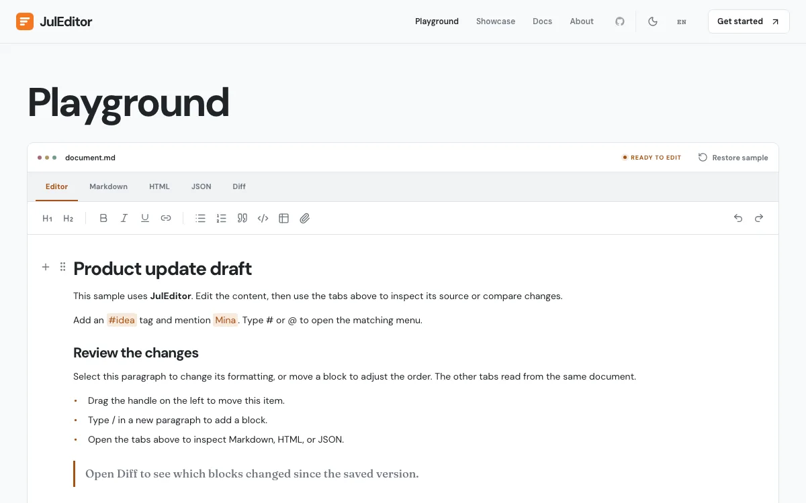
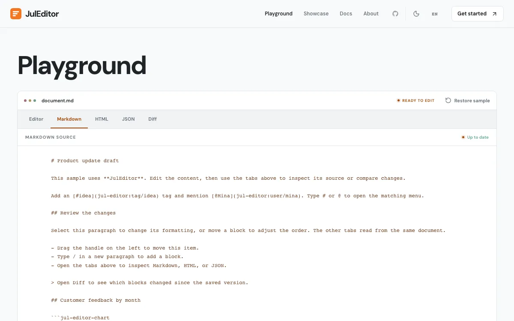
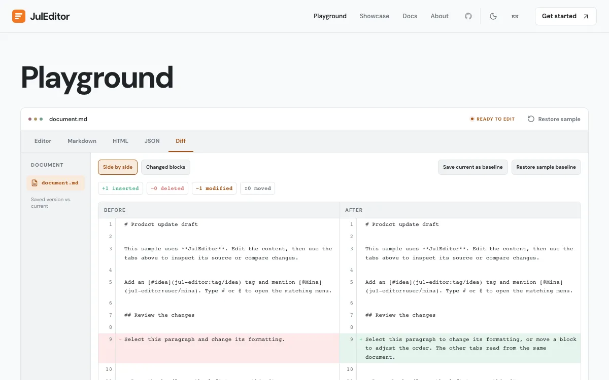

# JulEditor

A headless block editor for the web, with React components and optional plugins. [한국어](docs/README.ko.md)

## Features

- **Block editing** — Rich text, headings, lists, tables, images, embeds, and drag handles.
- **Composable UI** — React editor components, toolbars, slash commands, and menus.
- **Portable content** — Markdown, HTML, JSON, and plain-text conversion.
- **Extensible** — Custom blocks, marks, input rules, and optional plugins.
- **Document tools** — Diff, comments, collaboration, charts, and paged documents.
- **Customizable** — Styling tokens and English or Korean labels.

## Playground

<table>
  <tr>
    <td align="center" width="33%"> Editor</td>
    <td align="center" width="33%"> Markdown</td>
    <td align="center" width="33%"> Diff</td>
  </tr>
</table>

## License

[MIT](LICENSE)
