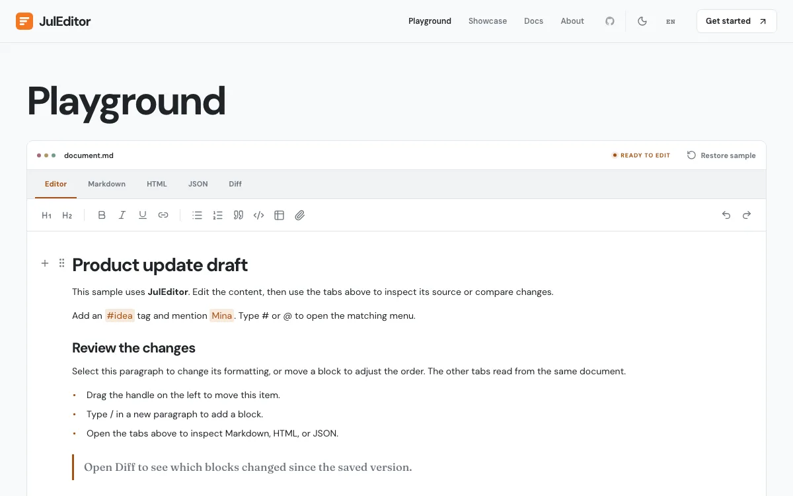
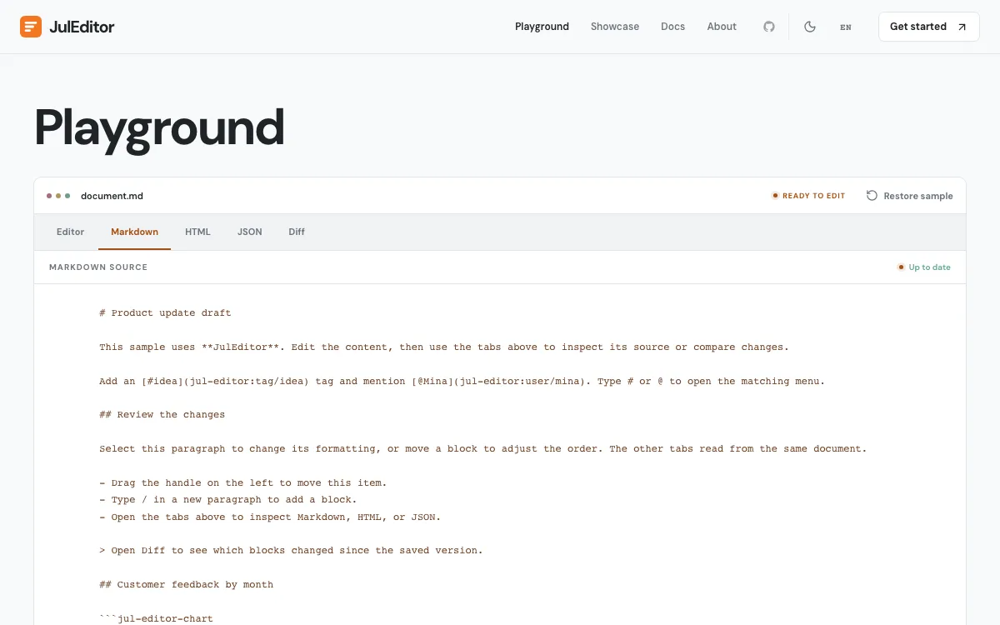
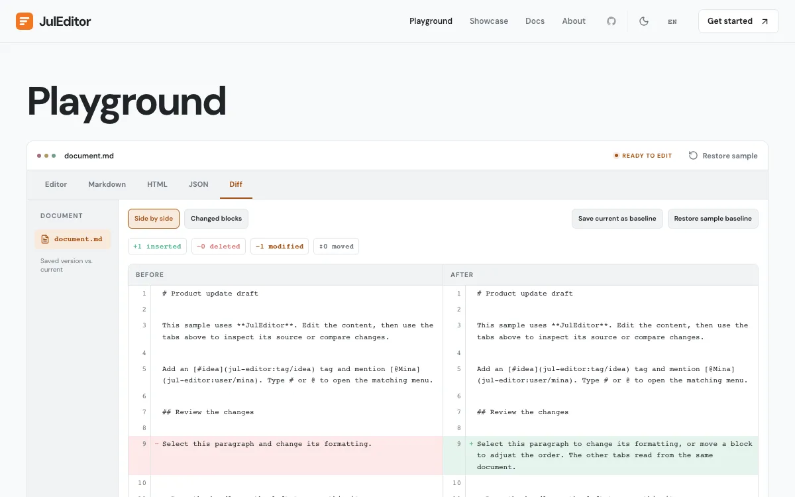

# JulEditor

React 컴포넌트와 선택형 플러그인을 제공하는 웹용 헤드리스 블록 에디터입니다. [English](../README.md)

## 설치

```sh
pnpm add @jul-editor/core @jul-editor/react
```

React 18과 19를 지원합니다. 선택형 블록은 `@jul-editor/plugins`에 있고, 렌더러는 쓰는 플러그인 것만 설치하면 됩니다(차트는 `recharts`, 다이어그램은 `mermaid`, 코드 하이라이트는 `lowlight`).

## 빠른 시작

```tsx
import { Editor } from "@jul-editor/react";

export function App() {
  return (
    <Editor onChange={(doc) => console.log(doc)}>
      <Editor.Toolbar aria-label="Formatting">
        <Editor.Bold />
        <Editor.Italic />
        <Editor.Heading level={2} />
        <Editor.BulletList />
      </Editor.Toolbar>
      <Editor.Content />
      <Editor.SlashMenu />
    </Editor>
  );
}
```

## 패키지

| 패키지 | 설명 |
| --- | --- |
| [`@jul-editor/core`](https://www.npmjs.com/package/@jul-editor/core) | 문서 모델, 트랜잭션, 실행 취소 기록, Markdown·HTML 변환. React 없음. |
| [`@jul-editor/react`](https://www.npmjs.com/package/@jul-editor/react) | 컴파운드 `<Editor>` 컴포넌트, 훅, 툴바, 메뉴. 헤드리스, CSS 없음. |
| [`@jul-editor/plugins`](https://www.npmjs.com/package/@jul-editor/plugins) | 차트, 다이어그램, 데이터 표, 코드 하이라이트, 코드 워크스페이스, 문서 비교. |

## 기능

- **블록 편집** — 서식, 제목, 목록, 표, 이미지, 임베드, 드래그 핸들.
- **조합형 UI** — React 에디터 컴포넌트, 툴바, 슬래시 명령, 메뉴.
- **문서 변환** — Markdown, HTML, JSON, 일반 텍스트.
- **확장** — 사용자 정의 블록, 마크, 입력 규칙, 선택형 플러그인.
- **문서 도구** — 비교, 댓글, 공동 편집, 차트, 페이지형 문서.
- **사용자 설정** — 스타일 토큰과 영어·한국어 레이블.

## 플레이그라운드

<table>
  <tr>
    <td align="center" width="33%"><br>에디터</td>
    <td align="center" width="33%"><br>Markdown</td>
    <td align="center" width="33%"><br>비교</td>
  </tr>
</table>

## 라이선스

[MIT](../LICENSE)
